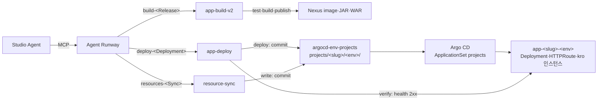

# argocd-env-projects

Agent Runway가 배포하는 앱의 GitOps 저장소입니다. Studio Agent가 Agent Runway MCP로 시작한 Deployment가 이 저장소에
배포 값을 기록하고, Argo CD가 그 값을 EKS `eks-demo`에 동기화합니다.
전체 계약은 [agent-platform `docs/APP_DELIVERY.md`](https://github.com/opspresso/agent-platform/blob/main/docs/APP_DELIVERY.md)와
[`docs/DELIVERY_RESOURCES.md`](https://github.com/opspresso/agent-platform/blob/main/docs/DELIVERY_RESOURCES.md)에 있습니다.

## 구성

| 경로 | 내용 | 쓰는 주체 |
| --- | --- | --- |
| `charts/app/` | 앱 Environment 하나의 wrapper chart. [opspresso/helm-charts](https://github.com/opspresso/helm-charts)의 `app` chart(argocd-env-apps의 sample-node·agent-*와 같은 chart)의 설정으로 Namespace·Deployment·Service·HTTPRoute·HPA·PDB·SecretStore·ExternalSecret·NetworkPolicy·ResourceQuota를 만든다. Namespace `app-<slug>-<env>`는 이 Application의 객체이므로 Project나 Environment가 없어지면 Argo CD가 namespace와 그 안의 모든 객체를 지운다. `app.yaml`이 없으면 Deployment·Service·HTTPRoute 없이 tenant 객체만 만든다. `app.raw`에는 환경 경계를 검사하는 guard와 kubelet 전용 Nexus pull ExternalSecret을 둔다 | 운영자(PR) |
| `charts/delivery/` | namespace `app-delivery`의 Argo Workflows WorkflowTemplate `app-build-v2`·`app-deploy`·`app-remove`·`resource-sync`·`env-cleanup`, CronWorkflow `env-cleanup`, 단계별 ServiceAccount·RBAC, 설정 | 운영자(PR) |
| `projects/<slug>/<env>/app.yaml` | Environment 하나의 `app` chart 값: 이미지 digest, 복제 수, port, env, 비밀이 아닌 Variable(ConfigMap), probe, 자원, 노드 architecture(`nodeSelector` `kubernetes.io/arch`, amd64는 NodePool taint `opspresso.com/arch=amd64:NoSchedule`의 toleration도). 시크릿 Variable은 SSM에서 ExternalSecret `app-env`로 받는다. `app-deploy`의 deploy 단계가 `charts/delivery/files/render.jq`로 Agent Runway의 선언에서 만든다 | `app-deploy` workflow가 쓰고 `app-remove` workflow가 지운다 |
| `projects/<slug>/<env>/resources.yaml` | Environment 하나의 AWS 전용 리소스(kro 인스턴스 `RdsPostgres`·`S3Bucket`·`DynamoTable`). Agent Runway가 렌더링한 manifest를 `resource-sync`의 write 단계가 검사해 기록한다 | `resource-sync` workflow만 |
| `projects/<slug>/<env>/resources/<name>.yaml` | Kubernetes 전용 리소스 하나의 chart 이름·버전과 값(`postgres`·`valkey`, opspresso/helm-charts). ApplicationSet `project-resources`가 파일마다 Application `app-<project>-<env>-<name>-<id 8자리>`를 만든다 | `resource-sync` workflow만 |
| `scripts/test.sh` | 두 chart를 Argo CD와 같은 parameter로 렌더링하고 계약을 검사한다 | |

Argo CD 객체는 [argocd-env-addons](https://github.com/opspresso/argocd-env-addons)의 `charts/argo-cd`가 선언합니다.

- AppProject `projects`: `app-*` namespace(단, `app-delivery` 제외)에 `charts/app`이 만드는 종류와 플랫폼 kro 인스턴스 종류만 허용합니다.
- AppProject `delivery`: `app-delivery` namespace(CronWorkflow 포함)와 `delivery-verify` ClusterRole만 허용합니다.
- Application `app-delivery`: `charts/delivery`를 동기화합니다.
- ApplicationSet `projects`: `projects/<slug>/<env>` 디렉터리마다 Application `app-<slug>-<env>`를 만듭니다.
  환경 목록을 따로 두지 않습니다. Agent Runway가 디렉터리를 쓴 환경이 곧 배포 대상입니다. Application은 `charts/app`(값: `app.yaml`)과 `resources.yaml`을 함께 동기화합니다.
  Project·Environment·namespace·도메인은 디렉터리 경로와 클러스터 설정에서 정하고, `charts/app`의 guard가 검사합니다.
  guard는 값 파일의 `app.raw`로 끌 수 있으므로 보조 방어입니다. 실제 경계는 `app.yaml`을 `deploy` 단계만 고정 매핑 `render.jq`로 쓰고,
  deploy key를 `delivery-git` 단계(`deploy`·`remove`·`write`·`prune`)만 가진다는 점입니다.

## 배포 흐름

Agent Runway는 build 한 번의 결과를 Release로, Release를 한 환경에 배포하는 작업을 Deployment로 기록합니다.
승격은 같은 Release(같은 image digest)를 다음 환경에 배포하는 것입니다.



| WorkflowTemplate | 단계 | ServiceAccount | 하는 일 |
| --- | --- | --- | --- |
| `app-build-v2` | `checkout` | `delivery-source` | 그 commit의 소스 아카이브(`source`, S3)를 풀고 commit SHA(`revision`)를 기록한다. Agent Runway가 한 사용자의 Git 권한으로 저장소를 읽어 올린 것이며, 이 단계와 클러스터는 Git 자격 증명을 갖지 않는다. 소스에는 `.git`이 없다 |
| `app-build-v2` | `check-application` | `delivery-runner` | `application.yaml`이 Agent Runway에 적용한 파일과 같은지 SHA-256으로 확인한다. 다르면 exit code 3이다 |
| `app-build-v2` | `test` | `delivery-runner` | `runtime.test.image`에서 `runtime.test.command`를 실행한다. 없으면 건너뛴다 |
| `app-build-v2` | `build` | `delivery-runner` | 요청한 architecture의 노드에서 kaniko `--no-push`로 컨테이너 tar를 만든다. 게시 자격 증명과 AWS identity가 없다 |
| `app-build-v2` | `build-artifact` | `delivery-runner` | 선언한 builder image와 command로 JAR/WAR를 만든다. 게시 자격 증명이 없다 |
| `app-build-v2` | `publish-image`·`publish-artifact` | `delivery-runner` | 소스 volume을 읽기 전용으로 연결한다. 별도 Nexus 게시 계정으로 산출물을 올리고 digest 또는 SHA-256·크기를 검증한다 |
| `app-deploy` | `deploy` | `delivery-git` | 이미지가 그 Project의 digest 고정 이미지인지 확인하고 `projects/<slug>/<env>/app.yaml`에 기록한다. 이 저장소에만 쓰기 권한이 있는 deploy key(SSM `/k8s/common/app-delivery/gitops-deploy-key`)로 push한다 |
| `app-deploy` | `verify` | `delivery-verify` | rollout 완료(최대 10분)와 `https://<host><health>`의 2xx 응답(최대 3분)을 기다린다. 이 rollout의 컨테이너가 3번 재시작한 뒤 `CrashLoopBackOff`이면 기다리지 않고 실패한다. 앱 출력은 시크릿을 담을 수 있으므로 적지 않는다 |
| `app-remove` | `remove` | `delivery-git` | `projects/<slug>/<env>/app.yaml`을 지운다. 리소스는 그대로 둔다 |
| `app-remove` | `verify` | `delivery-verify` | Argo CD가 namespace의 Deployment `app`을 지울 때까지 기다린다 |
| `app-remove` | `cleanup` | `delivery-verify`·`delivery-git` | `env-cleanup`의 `check-and-prune`. 아래 `env-cleanup`의 `live`·`prune`과 같다. 이 Workflow가 이미 잡은 mutex 안에서 실행한다 |
| `app-deploy-eb` | `deploy` | `delivery-target` | Nexus 파일을 읽기 계정으로 내려받아 기록한 SHA-256·크기를 확인한다. JAR/ROOT.war와 EB 환경 secret의 SSM ARN 참조를 bundle에 넣고 target 계정의 stack을 배포한다. 설치 스크립트는 prebuild hook으로 실행하며 실패하면 배포가 실패한다 |
| `app-deploy-eb` | `verify` | `delivery-target` | Elastic Beanstalk 환경이 이 Deployment의 version을 `Ok` health로 실행하고 `https://<host><health>`가 2xx를 반환할 때까지 기다린다 |
| `app-remove-eb` | `remove`·`verify` | `delivery-target` | stack `runway-<slug>-<env>`를 지우고 없어졌는지 확인한다. 리소스와 Variable은 남긴다 |
| `app-deploy-vmss` | `deploy` | `delivery-target` | Nexus 파일을 읽기 계정으로 내려받아 기록한 SHA-256·크기를 확인한다. 앱 identity에 선언한 secret과 bundle container만 읽는 역할을 주고, JAR와 실행 설정을 container에 올린 뒤 `vmss-app.json`과 Front Door route를 배포한다. 새 instance가 healthy가 되고 Front Door가 도메인을 확인할 때까지 기다린다 |
| `app-deploy-vmss` | `verify` | `delivery-target` | scale set이 이 Deployment를 싣고 모든 instance가 그 model로 healthy인지(최대 10분), `https://<host><health>`가 2xx를 반환하는지(최대 60분) 확인한다 |
| `app-remove-vmss` | `remove`·`verify` | `delivery-target` | Front Door route·custom domain·origin group, DNS 레코드, scale set·autoscale·load balancer·public IP, 앱 identity와 역할 할당, bundle container를 지우고 없어졌는지 확인한다. 리소스와 Variable(Key Vault secret)은 남긴다 |
| `resource-sync` | `write` | `delivery-git` | manifest가 허용한 kro 인스턴스 종류(`resourceKinds`) 또는 chart(`resourceCharts`)이고 그 환경 namespace에 속하는지, 이름이 `^[a-z]([a-z0-9-]{0,48}[a-z0-9])?$`이고 고유한지 확인하고 `projects/<slug>/<env>/resources.yaml`과 `resources/<name>.yaml`을 통째로 바꾼다. 리소스를 모두 지우려면 `{apiVersion: v1, kind: List, items: []}` 문서를 보낸다. 빈 manifest는 거부한다 |
| `resource-sync` | `cleanup` | `delivery-verify`·`delivery-git` | `env-cleanup`의 `locked`. `deploy-<slug>-<env>` mutex를 잡고 `check-and-prune`을 실행한다 |
| `env-cleanup` | `scan` | `delivery-verify` | 공개 저장소를 자격 증명 없이 clone하고, `app.yaml`·`resources/<name>.yaml`이 없고 `resources.yaml`에 주석만 있는 환경 디렉터리를 찾는다 |
| `env-cleanup` | `live` | `delivery-verify` | namespace에 kro 인스턴스(`RESOURCE_KINDS`)·StatefulSet·PVC가 남았는지 확인한다(삭제 중인 객체 포함). 남아 있으면 `not empty yet`을 기록하고 성공한다. API 오류만 실패한다 |
| `env-cleanup` | `prune` | `delivery-git` | `live`가 남은 객체가 없다고 할 때만 실행한다. `commit.sh PRUNE_EMPTY`로 디렉터리가 여전히 비었으면 지우고, 아니면 `not empty`를 출력하고 아무것도 바꾸지 않는다 |

VM Target Workflow(`app-deploy-eb`·`app-remove-eb`·`app-deploy-vmss`·`app-remove-vmss`)는 Agent Runway가 보낸 값만 씁니다.

- instance type과 instance 수: parameter `application`의 `environment.instanceType`, `environment.replicas`(최소), `environment.maxReplicas`(최대). Agent Runway가 Project의 크기 등급을 이 값으로 바꿉니다. `environment.instanceType`이 없거나 instance type 형식이 아니면 `deploy` 단계가 실패합니다. `vmss`에서는 Azure VM size(`Standard_...`)이고, `environment.architecture`(`amd64`·`arm64`)와 맞아야 합니다. arm64 size는 vCPU 수 뒤에 `p`가 있습니다(예: `Standard_D2ps_v5`).
- 교체 방식: parameter `application`의 `environment.rollout`(선택). 값이 없거나 `immutable`이면 새 instance가 health check를 통과한 뒤에 기존 instance를 바꿉니다(Elastic Beanstalk `Immutable`, VM scale set의 surge rolling upgrade). 실패한 배포는 실행 중인 Release를 건드리지 않습니다. `all-at-once`이면 모든 instance가 새 Release를 한꺼번에 받습니다(Elastic Beanstalk `AllAtOnce`, VM scale set은 모든 instance를 한꺼번에 새로 만듭니다). 더 빠르지만 교체하는 동안, 그리고 실패한 뒤 되돌리는 동안 앱이 응답하지 않습니다. Agent Runway는 sandbox 환경에만 `all-at-once`를 보냅니다. 다른 값이면 `deploy` 단계가 실패합니다.
- `target.externalId`(선택, `^[A-Za-z0-9+=,.@:/-]{2,1224}$`): 다른 AWS 계정의 Target에 있습니다. `target.sh`가 deploy role을 넘겨받을 때 `--external-id`로 보냅니다. 형식이 다르면 단계가 실패합니다.
- `target.installScript`(선택, 16 KiB 이하, 첫 줄 `#!/bin/bash` 또는 `#!/bin/sh`): 관리자가 정한, 각 instance에 필요한 것을 설치하는 스크립트입니다. 비밀 값을 넣지 않습니다.

### Azure VM scale set(`vmss`)

`app-deploy-vmss`·`app-remove-vmss`의 단계는 `delivery-target`의 projected service-account token(audience `api://AzureADTokenExchange`)으로 `target.deployClientId` 앱에 로그인합니다(`target.sh` `azure_login`). Entra는 `system:serviceaccount:app-delivery:delivery-target`만 이 앱으로 받아들입니다. 이미지는 `mcr.microsoft.com/azure-cli:2.93.0`입니다.

| 리소스 | 위치 | 이름 |
| --- | --- | --- |
| 앱 identity(user-assigned), public IP, load balancer, VM scale set, autoscale 설정(`maxReplicas`가 `replicas`보다 클 때만) | `target.resourceGroup` | `runway-<slug>-<env>` |
| bundle container | `target.artifactStorage` | `runway-<slug>-<env>`. 이름에 `--`가 있으면 container 이름 규칙 때문에 `runway-<sha256(<slug>/<env>)의 앞 32자>` |
| origin group·origin `app`·custom domain·route | `target.frontDoorProfileId`, endpoint `runway` | `runway-<slug>-<env>` |
| DNS 레코드 | `target.dnsZoneId` | CNAME `<label>` → endpoint, TXT `_dnsauth.<label>` |

Azure 리소스에는 tag `opspresso-delivery-project`·`opspresso-delivery-env`가 붙습니다. scale set에는 마지막 Deployment ID(`opspresso-delivery-deployment`)도 붙습니다. DNS 레코드에는 tag가 없으므로 metadata `deliveryproject`·`deliveryenv`를 붙이고, `app-remove-vmss`는 이 metadata가 같은 레코드만 지웁니다. 같은 zone의 `<slug>.<domain>`이 Project의 다른 환경 것일 수 있기 때문입니다.

- secret: 앱의 `secrets`에 있는 이름마다 Key Vault secret `ar-<sha256(/agent-runway/<target.name>/<slug>/<env>/<NAME>)>`가 있어야 합니다. 없으면 `deploy` 단계가 instance를 바꾸기 전에 실패합니다. 단계는 secret의 metadata만 읽습니다. 앱 identity는 선언한 secret마다 `Key Vault Secrets User`, container에 `Storage Blob Data Reader`를 받습니다. 더 이상 선언하지 않은 secret의 역할은 지웁니다.
- bundle: container의 `<Deployment>/application.jar`와 `<Deployment>/runway.json`(실행 명령, `env`·`config`의 값, `PORT`, secret 이름)입니다. custom data는 두 blob의 SHA-256을 고정합니다. custom data와 template parameter에는 secret 값과 `env`·`config` 값이 없습니다.
- instance: Ubuntu 24.04(`Canonical:ubuntu-24_04-lts:server`, arm64는 `server-arm64`)에서 `vmss-boot.sh`가 한 번 실행됩니다. Adoptium 저장소(서명 키 `adoptium.asc`)의 `target.javaRuntime`과 nginx를 설치하고, `target.installScript`를 실행하고, 앱 identity로 bundle과 secret을 읽습니다. secret과 값은 `/etc/runway/env.json`(서비스 사용자 `runway`만 읽기)에만 쓰고, systemd unit `runway-app`이 앱을 실행합니다. 설치 스크립트가 실패하면 앱이 시작하지 않고 배포가 실패합니다.
- 포트: 앱은 `runtime.port`(`PORT`)에서 받습니다. nginx가 port 80에서 그 포트로 전달합니다(EB와 같은 구조). subnet의 network security group은 port 80에 `AzureFrontDoor.Backend`만 허용합니다. 그 주소는 다른 Front Door profile도 쓰므로, nginx는 이 profile의 `X-Azure-FDID` 요청과 load balancer probe(`168.63.129.16`)만 받습니다. `runtime.port`는 61000일 수 없습니다(Application Health extension의 endpoint).
- health: load balancer probe와 Front Door probe는 port 80의 `runtime.health`를 HTTP로 확인합니다. Application Health extension(rich state)은 `127.0.0.1:61000/runway-health`를 확인합니다. 이 endpoint는 앱의 health 경로가 2xx일 때만 `Healthy`를 반환합니다. redirect는 실패입니다. 새 instance는 최대 20분 동안 `Initializing`으로 기다립니다.
- HTTPS: Front Door가 managed certificate로 `https://<host>`를 받고 HTTP는 HTTPS로 보냅니다. origin은 load balancer의 public IP이고 HTTP로 전달합니다. Host header는 `<host>`입니다.
- immutable 교체: rolling upgrade가 한 번에 최대 20%(최소 1대)의 새 instance를 먼저 만듭니다. `replicas`가 1이면 추가 instance는 1대입니다. 새 instance가 healthy가 아니면 upgrade가 멈추고 기존 instance가 남습니다. rolling upgrade가 `Completed`가 되었는데도 이전 model의 instance가 1분 넘게 남으면, `deploy` 단계가 변경 없는 `az vmss update`로 rolling upgrade를 다시 시작합니다(최대 2번). Azure는 model을 바꾼 첫 upgrade에서 instance 2대 중 1대만 바꾸고 끝낸 적이 있습니다. 세 번째에도 남으면 `deploy` 단계가 실패합니다.
- 대기 시간: `deploy`는 instance를 최대 25분, 도메인 확인을 단계 시간(55분) 안에서 기다립니다. `verify`의 HTTPS 확인은 최대 60분입니다. Front Door는 새 custom domain마다 관리형 인증서를 발급합니다. 서비스를 지운 뒤 같은 host로 다시 배포할 때도 새로 발급합니다. 이 인증서가 Front Door edge에 배포되기까지 몇 분에서 1시간이 걸립니다([Microsoft Learn](https://learn.microsoft.com/azure/frontdoor/standard-premium/how-to-configure-https-custom-domain)). eks-demo `dmz`에서는 도메인 확인 뒤 21분이 걸렸습니다. 그래서 host의 첫 배포는 25분 이상 걸릴 수 있습니다.
- `runtime.health`는 영문자·숫자·`._~/-`로 된 경로만 받습니다. WAR는 거부합니다.

Azure에서 template과 요청 body를 바꾸면 다음으로 확인합니다. 읽기와 preflight 검증만 하며 리소스를 만들거나 바꾸지 않습니다.

```bash
python3 scripts/vmss_validate.py <target JSON 파일> [<VM size> <architecture>]   # az login 필요
python3 scripts/vmss_boot_check.py [amd64|arm64]                               # Docker 필요, Ubuntu 24.04에서 vmss-boot.sh 실행
```

`build` 단계는 그 architecture의 build NodePool `delivery-amd64`·`delivery-arm64`(terraform-env-opsp `demo/7-eks-shared`, 노드 디스크 200Gi)에서만 실행합니다.
kaniko는 Dockerfile의 `RUN`을 같은 컨테이너에서 실행하므로 빌드의 메모리와 파일이 모두 이 컨테이너의 자원입니다.
요청은 CPU 1개·메모리 2Gi·디스크 20Gi이고, 한도는 메모리 24Gi·디스크 150Gi입니다. 메모리 한도를 넘으면 OOM으로, 디스크 한도를 넘으면 kubelet eviction으로 실패하며 다시 실행하지 않습니다.
`build`는 최대 2시간, Workflow 전체는 최대 3시간입니다. kaniko `--cleanup`이 빌드가 끝나면(실패해도) 빌드 파일을 지워, 로그 때문에 1일 남는 Pod가 노드 디스크를 차지하지 않습니다.
`test`·`build`·`build-artifact` Pod에는 `karpenter.sh/do-not-disrupt: "true"`가 있어 Karpenter가 통합(consolidation)을 위해 옮기지 않습니다.

빌드 노드는 Spot일 수 있습니다. Pod 유실·SIGTERM에 한해 최대 2번 재개합니다. 앱 명령의 실패는 다시 실행하지 않습니다. 게시 재개는 기존 산출물의 digest·해시를 확인하며 다른 바이트로 덮어쓰지 않습니다. 자격 증명을 source volume에 남기지 않습니다.

`resource-sync`는 `resources-<slug>-<env>`, `app-deploy`와 `app-remove`는 같은 `deploy-<slug>-<env>` mutex를 잡습니다.
환경 디렉터리는 commit 두 번으로 지웁니다. 마지막 `app.yaml`이나 리소스를 지우는 commit은 디렉터리에 빈 `resources.yaml`을 남깁니다. 그래서 Application이 남아 있는 동안 Argo CD가 workload와 리소스를 정리합니다. namespace에 리소스 객체(kro 인스턴스·StatefulSet·PVC)가 남지 않았으면 `cleanup` 단계가 디렉터리를 지우는 두 번째 commit을 만듭니다. ApplicationSet이 빈 Application을 삭제하고, Argo CD가 남은 테넌트 객체를 정리합니다. 객체가 남은 `S3Bucket`처럼 아직 삭제 중인 객체가 있거나 그 사이에 `app.yaml`·리소스가 다시 생기면 디렉터리는 빈 선언으로 남습니다. Workflow는 성공합니다. CronWorkflow `env-cleanup`이 15분마다 `scan`으로 빈 선언 디렉터리를 찾고, 환경마다 `deploy-<slug>-<env>` mutex 안에서 `live`·`prune`을 다시 실행합니다. 지울 디렉터리가 없으면 commit하지 않습니다. Argo CD가 만든 namespace는 남습니다. 같은 환경의 다음 Workflow는 앞 Workflow가 끝날 때까지 `Pending`으로 기다리고, 다른 환경과 `app-build-v2`는 기다리지 않습니다.

`test`·`build`는 앱 코드를 실행합니다. 이 Pod는 Git 자격 증명·AWS·Kubernetes 권한을 받지 않고, NetworkPolicy
`delivery-runner`로 DNS와 공인 인터넷에만 연결합니다.

## 앱 주소

앱 주소는 Agent Runway가 Project 환경마다 정하고, `deploy` 단계가 `app.yaml`의 `app.routing.hosts`에 씁니다.
`charts/app`의 guard는 그 Project 환경의 두 주소만 허용합니다.

| 단계 | 주소 |
| --- | --- |
| Project 파이프라인의 마지막 단계 | `https://<slug>.apps.rovr.dev` |
| 그 밖의 단계(예: `dev`) | `https://<slug>-<env>.apps.rovr.dev` |

Project가 모든 단계에 환경 이름을 붙이도록 고르면 마지막 단계도 `https://<slug>-<env>.apps.rovr.dev`입니다.
환경은 Agent Runway 콘솔에서만 관리합니다. 이 저장소와 argocd-env-apps에는 환경 목록이 없습니다.

인증서와 DNS는 terraform-env-demo `demo/3-alb`가 관리합니다. Nexus 저장소와 읽기·게시·삭제 계정은 argocd-env-addons의 Nexus 동기화가 준비합니다.

## 변경과 검증

chart를 바꾸면 다음을 실행합니다. Helm 4와 Python `pyyaml`이 필요합니다.

```bash
./scripts/test.sh
```

- `projects/`는 직접 고치지 않습니다. 값을 바꾸려면 앱 저장소의 `application.yaml`을 고치고 Agent Runway에 다시 적용한 뒤 새 Delivery를 시작합니다.
- 앱은 Runway의 `service_remove`로, 프로젝트 전체는 `project_delete`로 삭제합니다. 서비스와 리소스가 없어지면 workflow가 빈 디렉터리를 정리하고 Argo CD가 namespace까지 제거합니다. GitOps 파일이나 namespace를 직접 삭제하지 않습니다. DB·bucket의 데이터와 snapshot 보존은 각 리소스의 삭제 정책을 따릅니다.
- 환경 하나에 `RdsPostgres`·`S3Bucket`·`DynamoTable`은 종류마다 2개까지입니다(ResourceQuota `count/rdspostgres.kro.run`·`count/s3buckets.kro.run`·`count/dynamotables.kro.run`). 볼륨은 4개, 합계 200Gi까지입니다.

## 환경 추가

Agent Runway 콘솔에서 환경을 추가하면 됩니다. 이 저장소와 argocd-env-apps는 바꾸지 않습니다.

- Agent Runway는 기존 Project slug가 `-<새 환경>`으로 끝나면 환경 추가를 거절합니다(`host_conflict`). 그 Project의 주소가 다른 Project의 새 환경 주소와 겹치기 때문입니다.
- 새 환경에 처음 배포하거나 리소스를 만들면 Agent Runway가 `projects/<slug>/<env>` 디렉터리를 쓰고, ApplicationSet이 그 Application을 만듭니다.
- 환경의 Application은 그 디렉터리가 없어질 때 지워집니다. 서비스와 리소스를 모두 삭제하면 `env-cleanup`이 디렉터리를 지웁니다.
- 성공·실패한 Workflow는 1일 동안 남습니다. `app-build-v2`·`app-deploy`는 성공·실패와 관계없이 단계 Pod와 로그도 같은 기간 남아
  Agent Runway의 `deployment_logs`로 읽을 수 있습니다. `resource-sync`는 실패한 Workflow의 Pod만 남깁니다.

### 앱 준비 상태와 생존 확인

`runtime.health`는 startup·readiness probe와 배포 검증에 사용합니다. 선택 필드 `runtime.liveness`는 EKS liveness probe에만 사용하며, 생략하면 `health`와 같은 경로입니다. DB를 쓰는 새 앱은 준비 상태 경로에서 현재 DB 연결을 확인하고, 생존 경로에서는 프로세스 응답만 확인합니다. DB 장애가 트래픽을 중단하되 불필요한 Pod 재시작을 일으키지 않도록 두 경로를 분리합니다. EB의 상태 확인은 계속 `runtime.health`를 사용합니다.


## Nexus와 native 배포 설정

`charts/delivery`에는 `registry`(예: `nexus.example/runway-images`)와 `artifactRepository`
(예: `https://nexus.example/repository/runway-artifacts`)를 함께 지정한다. 두 저장소는 immutable 게시 정책을 사용한다.
`delivery-nexus` ExternalSecret은 SSM의 publisher·reader 비밀번호를 가져온다. 게시 계정은 두 publisher 단계만,
읽기 계정은 native deploy 단계만 받는다. EKS 앱의 kubelet은 별도 `nexus-reader` Secret을 사용하며 앱 환경 변수에는 넣지 않는다.

빌드와 테스트는 Project architecture의 노드에서 실행한다. `platforms`는 하나만 받으며 QEMU를 사용하지 않는다.
Nexus 이미지 tag는 `<pipeline>-<Release ID>`, 파일 경로는 `<project>/<pipeline>/<Release ID>/app.<format>`이다.
승격은 이 산출물을 다시 빌드하지 않는다. 파일 출력은 일반 파일 하나, 최대 450 MiB이며 symlink·경로 이탈·해시 불일치를 거부한다.

EB는 Java SE의 executable JAR 또는 Tomcat의 ROOT.war를 실행한다. Docker Compose와 instance ECR pull은 사용하지 않는다.
현재 Java 플랫폼의 `environmentsecrets` 기능으로 SSM ARN만 전달하며 secret 값을 bundle에 저장하지 않는다.
기존 ECR workflow와 호환되지 않으므로 진행 중인 배포를 끝내고, 서비스·workflow·Nexus 설정을 함께 전환한다.

### EB 환경별 산출물 권한

EB 기본 `AWSElasticBeanstalkWebTier` 정책은 다른 환경의 S3 번들도 읽을 수 있으므로 사용하지 않습니다.
인스턴스 역할은 해당 EB 환경 ID의 S3 경로와 환경 이름의 CloudWatch 로그만 읽거나 쓸 수 있습니다.
SSM은 해당 Project·환경 경로만 허용합니다.
EB 버킷 정책이 역할에 직접 부여하는 권한도 있으므로, 다른 환경 객체 읽기·목록 조회에는 명시적 거부를 둡니다.
앱은 자신의 로그 경로에만 쓸 수 있으며, 배포 번들을 덮어쓸 수 없습니다.
자기 환경의 tail·bundle·publish·deployments 로그 경로는 유지합니다.

새 환경은 사용자 코드·설정·설치 스크립트·시크릿 참조가 없는 플랫폼 준비 앱으로 먼저 만듭니다.
환경 ID를 조회한 뒤 별도의 CloudFormation 업데이트로 역할 범위를 제한합니다.
이 업데이트와 정책 재조회가 성공한 뒤에만 사용자 번들을 올려 배포합니다. 준비 앱에는 사용자 도메인을 연결하지 않습니다.
기존 환경은 현재 번들을 유지하는 권한 업데이트부터 수행합니다.
조회 오류는 환경 부재로 처리하지 않습니다. 삭제 단계와 삭제 확인도 인증·통신 오류나 잘못된 응답을 성공으로 바꾸지 않습니다. 권한 제한 실패나 환경 소유권 불일치가 있으면 사용자 코드 배포를 중단합니다.

근거: [AWS의 환경 간 S3 접근 제한 안내](https://docs.aws.amazon.com/elasticbeanstalk/latest/dg/AWSHowTo.iam.cross-env-s3-access.html).
