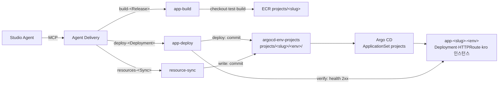

# argocd-env-projects

Agent Delivery가 배포하는 앱의 GitOps 저장소입니다. Studio Agent가 Agent Delivery MCP로 시작한 Delivery가 이 저장소에
배포 값을 기록하고, Argo CD가 그 값을 EKS `eks-demo`에 동기화합니다.
전체 계약은 [agent-platform `docs/APP_DELIVERY.md`](https://github.com/opspresso/agent-platform/blob/main/docs/APP_DELIVERY.md)와
[`docs/DELIVERY_V2.md`](https://github.com/opspresso/agent-platform/blob/main/docs/DELIVERY_V2.md)에 있습니다.

## 구성

| 경로 | 내용 | 쓰는 주체 |
| --- | --- | --- |
| `charts/app/` | 앱 Environment 하나의 wrapper chart. [opspresso/helm-charts](https://github.com/opspresso/helm-charts)의 `app` chart(argocd-env-apps의 sample-node·agent-*와 같은 chart)의 설정으로 Deployment·Service·HTTPRoute·HPA·PDB·SecretStore·ExternalSecret·NetworkPolicy·ResourceQuota를 만든다. `app.yaml`이 없으면 Deployment·Service·HTTPRoute 없이 tenant 객체만 만든다. `app.raw`에는 환경·namespace·host·image digest를 검사하는 guard만 둔다 | 운영자(PR) |
| `charts/delivery/` | namespace `app-delivery`의 Argo Workflows WorkflowTemplate `app-build`·`app-deploy`·`resource-sync`, 단계별 ServiceAccount·RBAC, 설정 | 운영자(PR) |
| `projects/<slug>/<env>/app.yaml` | Environment 하나의 `app` chart 값: 이미지 digest, 복제 수, port, env, probe, 자원. `app-deploy`의 deploy 단계가 `charts/delivery/files/render.jq`로 Agent Delivery의 선언에서 만든다 | `app-deploy` workflow만 |
| `projects/<slug>/<env>/resources.yaml` | Environment 하나의 namespace 리소스(kro 인스턴스, 예: `RdsPostgres`). Agent Delivery가 렌더링한 manifest를 `resource-sync`의 write 단계가 검사해 기록한다 | `resource-sync` workflow만 |
| `scripts/test.sh` | 두 chart를 Argo CD와 같은 parameter로 렌더링하고 계약을 검사한다 | |

Argo CD 객체는 [argocd-env-addons](https://github.com/opspresso/argocd-env-addons)의 `charts/argo-cd`가 선언합니다.

- AppProject `projects`: `app-*` namespace(단, `app-delivery` 제외)에 `charts/app`이 만드는 종류와 플랫폼 kro 인스턴스 종류만 허용합니다.
- AppProject `delivery`: `app-delivery` namespace와 `delivery-verify` ClusterRole만 허용합니다.
- Application `app-delivery`: `charts/delivery`를 동기화합니다.
- ApplicationSet `projects`: 허용한 환경 목록(`app_delivery.environments`)의 `projects/*/<env>` 디렉터리마다
  Application `app-<slug>-<env>`를 만듭니다. Application은 `charts/app`(값: `app.yaml`)과 `resources.yaml`을 함께 동기화합니다.
  Project·Environment·namespace·도메인은 디렉터리 경로와 클러스터 설정에서 정합니다. 파일 내용으로 바꿀 수 없습니다.

## Delivery 흐름

Agent Delivery는 build 한 번의 결과를 Release로, Release를 한 환경에 배포하는 작업을 Deployment로 기록합니다.
승격은 같은 Release(같은 image digest)를 다음 환경에 배포하는 것입니다.



| WorkflowTemplate | 단계 | ServiceAccount | 하는 일 |
| --- | --- | --- | --- |
| `app-build` | `checkout` | `delivery-git` | 요청한 ref를 clone하고 commit SHA를 기록한다. Secret `<workflow>-checkout`의 token이 있으면(관리자가 허용한 비공개 저장소) github.com 요청 header로만 쓴다 |
| `app-build` | `check-application` | `delivery-runner` | `application.yaml`이 Agent Delivery에 적용한 파일과 같은지 SHA-256으로 확인한다. 다르면 exit code 3이다 |
| `app-build` | `test` | `delivery-runner` | `runtime.test.image`에서 `runtime.test.command`를 실행한다. 없으면 건너뛴다 |
| `app-build` | `registry` | `delivery-registry` | ECR repository를 만들고, 같은 commit 이미지가 있으면 재사용한다. 없으면 그 Project에만 push할 수 있는 credential을 만든다 |
| `app-build` | `build` | `delivery-runner` | kaniko로 linux/arm64 이미지를 빌드해 commit SHA tag로 push한다. user namespace·privileged가 필요 없다 |
| `app-deploy` | `deploy` | `delivery-git` | 이미지가 그 Project의 digest 고정 이미지인지 확인하고 `projects/<slug>/<env>/app.yaml`에 기록한다. 이 저장소에만 쓰기 권한이 있는 deploy key(SSM `/k8s/common/app-delivery/gitops-deploy-key`)로 push한다 |
| `app-deploy` | `verify` | `delivery-verify` | rollout 완료와 `https://<host><health>`의 2xx 응답을 기다린다 |
| `resource-sync` | `write` | `delivery-git` | manifest가 허용한 kro 인스턴스 종류(`resourceKinds`)이고 그 환경 namespace에 속하는지 확인하고 `projects/<slug>/<env>/resources.yaml`에 기록한다. 빈 manifest는 그 환경의 리소스를 모두 지운다 |

`test`·`build`는 앱 코드를 실행합니다. 이 Pod는 Git 자격 증명·AWS·Kubernetes 권한을 받지 않고, NetworkPolicy
`delivery-runner`로 DNS와 공인 인터넷에만 연결합니다.

## 앱 주소

환경 목록과 primary 환경은 argocd-env-addons의 `app_delivery.environments`·`app_delivery.primary_environment`가 정합니다.
Agent Delivery의 `DELIVERY_ENVIRONMENTS`와 같아야 합니다. 기본값은 `[dev, prod]`, primary는 `prod`입니다.

| Environment | 주소 |
| --- | --- |
| primary(기본 `prod`) | `https://<slug>.apps.rovr.dev` |
| 그 밖의 환경(예: `dev`) | `https://<slug>-<env>.apps.rovr.dev` |

인증서와 DNS는 terraform-env-demo `demo/3-alb`가, push 역할은 `demo/8-app-delivery`가 만듭니다.

## 변경과 검증

chart를 바꾸면 다음을 실행합니다. Helm 4와 Python `pyyaml`이 필요합니다.

```bash
./scripts/test.sh
```

- `projects/`는 직접 고치지 않습니다. 값을 바꾸려면 앱 저장소의 `application.yaml`을 고치고 Agent Delivery에 다시 적용한 뒤 새 Delivery를 시작합니다.
- 앱을 내리려면 `projects/<slug>/<env>/` 디렉터리를 지우는 PR을 병합합니다. Argo CD가 Application과 그 리소스(kro 인스턴스 포함)를 지웁니다.
  namespace `app-<slug>-<env>`는 남으므로 확인한 뒤 지웁니다.
- 성공·실패한 Workflow는 1일 동안 남습니다. 실패한 Workflow는 Pod와 로그도 같은 기간 남습니다.
